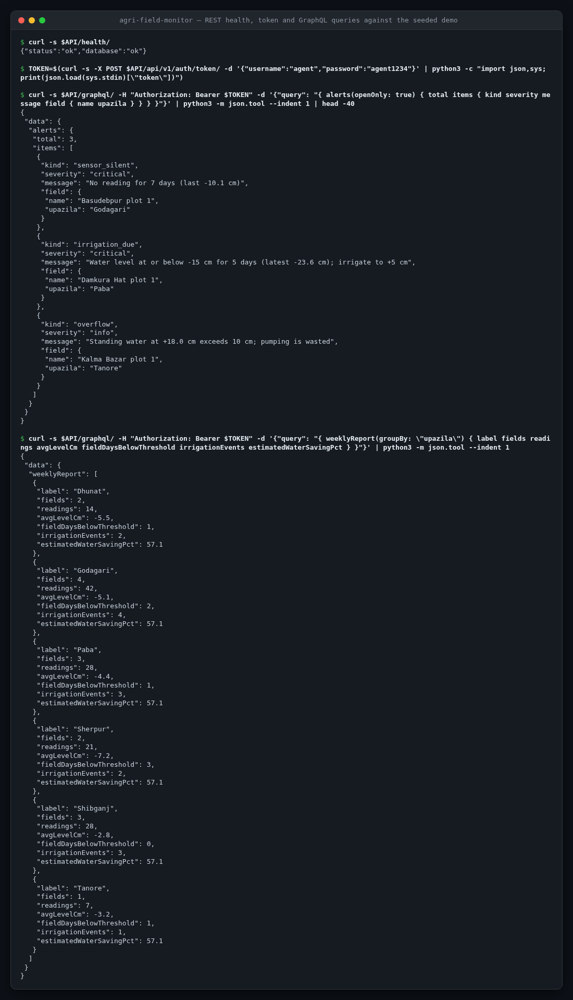
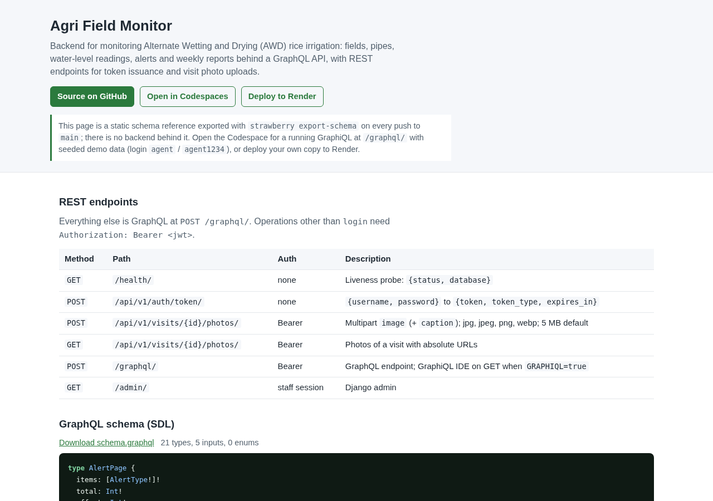
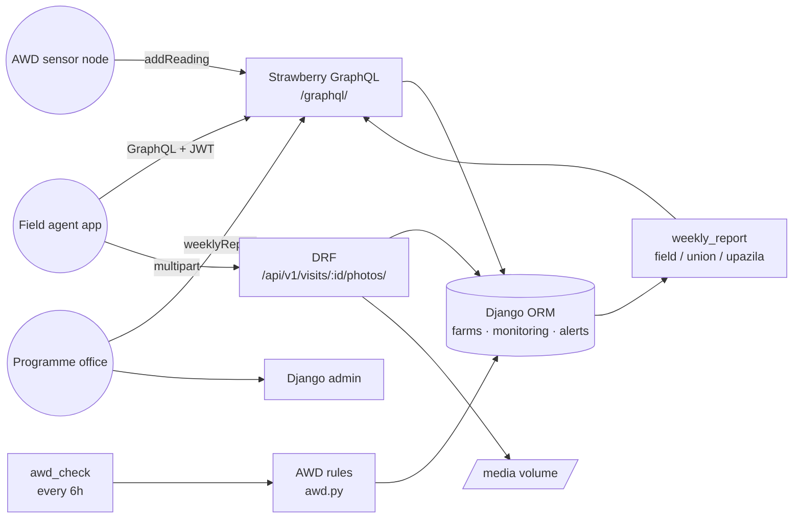

<!-- topics: django,graphql,strawberry-graphql,python,agritech,agriculture,irrigation,gis,bangladesh -->
# Agri Field Monitor

Backend for monitoring Alternate Wetting and Drying (AWD) rice irrigation: fields, pipes, water-level readings, alerts and weekly reports behind a GraphQL API.

[](https://github.com/AkibUllah/agri-field-monitor/actions/workflows/ci.yml)
[](https://github.com/AkibUllah/agri-field-monitor/actions/workflows/codeql.yml)
[](https://github.com/AkibUllah/agri-field-monitor/releases)


## Try it live

| | |
|---|---|
| Schema reference | https://akibullah.github.io/agri-field-monitor/ — GraphQL SDL exported with `strawberry export-schema` plus the REST endpoints (static; no backend behind it) |
| Run in your browser | [](https://codespaces.new/AkibUllah/agri-field-monitor?quickstart=1) — starts web + scheduler + PostgreSQL with `docker compose`, migrates and runs `seed_demo`; open forwarded port 8000 at `/graphql/` (GraphiQL) and log in with `agent` / `agent1234` via the `login` mutation or `POST /api/v1/auth/token/`. |
| One-click deploy | [](https://render.com/deploy?repo=https://github.com/AkibUllah/agri-field-monitor) — `render.yaml` provisions the web service and a free PostgreSQL; the container migrates and seeds on start. Visit photos live on the container disk, which the free plan does not persist. |
| Local | `docker compose up` (see Quick Start) |

## Screenshots



*A real session against a local instance seeded with `seed_demo`: health check, JWT from the token endpoint, the open AWD alerts (sensor silent, irrigation due, overflow) and the weekly report grouped by upazila.*



*The REST endpoints and GraphQL SDL in the [live schema reference](https://akibullah.github.io/agri-field-monitor/).*

## Why this exists

Boro rice in north-west Bangladesh is irrigated from shallow tube wells, and diesel is the farmer's biggest cash cost. AWD, letting the field dry until the water in a perforated tube sits 15 cm below the surface before re-flooding, cuts pumping by roughly a third without hurting yield, but only if somebody is actually reading the tubes. Extension programmes I have worked alongside collected those readings on paper and in WhatsApp groups, so nobody could tell which fields were overdue for irrigation or which agents had stopped visiting. This service is the data backbone for that work: readings from agents and sensors, rules that turn them into alerts, and weekly roll-ups by field, union and upazila for the programme office.

## Features

- Farmers, fields (boundary as GPS points, area via shoelace on a local projection, reported in m², hectare, acre, bigha and decimal), seasons with AWD windows
- Field tubes (pipes) with manual and device readings; irrigation events; field visits with notes, GPS and photos
- AWD rules: `IRRIGATION_DUE` when the daily minimum level stays at or below the field threshold (default -15 cm) for N consecutive days since the last irrigation, `OVERFLOW` for wasted standing water, `SENSOR_SILENT` when readings stop; one open alert per field and kind enforced by a DB constraint, auto-resolved when the condition clears
- Weekly progress report grouped by field, union or upazila: readings, average and minimum level, field-days below threshold, irrigation events per field, visits, alerts, and an estimated water saving against continuous flooding
- Strawberry GraphQL API with filtered, paginated queries and validated mutations; GraphiQL at `/graphql/`
- DRF endpoints for the things GraphQL is bad at: multipart photo upload (type and size validated) and token issuance; `/health/`
- Stateless JWT (PyJWT) shared by a Django middleware (GraphQL) and a DRF authentication class (REST)
- Django admin for every model with filters, search, inlines and a bulk "resolve" action
- `seed_demo` with Rajshahi and Bogura upazilas (Paba, Godagari, Tanore, Sherpur, Shibganj, Dhunat), three weeks of readings and one field in each alert state; `awd_check` command for cron
- Postgres via `DATABASE_URL`, SQLite for local work and tests; Dockerfile (gunicorn, non-root) and compose with a scheduler container

## Architecture



Key decisions:

- **Rules are pure functions.** `evaluate_field()` takes readings, the last irrigation time and a threshold and returns the alerts that should exist; `run_awd_check()` only does the ORM reconciliation (open what is missing, resolve what no longer applies). Tests cover the rules with plain data and the reconciliation with the DB.
- **Daily minimum, local calendar day.** AWD state is decided by the driest reading of the day in Asia/Dhaka time, and a single missed day does not reset the streak; two missed days in a row do.
- **Irrigation resets the clock.** Only readings after the last pump event count toward the drying streak, so logging an irrigation resolves the alert on the next check without anyone touching it.
- **Area from GPS without GIS dependencies.** Boundaries are a few hundred metres across, so an equirectangular projection around the centroid plus the shoelace formula is accurate to well under 1%, far better than hand-held GPS. No PostGIS required.
- **GraphQL for reads and writes, REST for files.** Multipart uploads through GraphQL are awkward on every client; a two-endpoint DRF surface keeps photos simple while JWT auth is shared.
- **One open alert per (field, kind)** is a partial unique constraint, not application logic, so a concurrent check cannot duplicate alerts.

## Tech Stack

| Layer | Choice |
|---|---|
| Framework | Django 4.2, Django REST Framework 3.15 |
| GraphQL | Strawberry GraphQL + strawberry-graphql-django (types mapped from models) |
| Auth | PyJWT HS256, middleware for GraphQL, DRF authentication class for REST |
| Database | PostgreSQL 16 (compose) / SQLite (dev, tests) via `DATABASE_URL` |
| Tooling | pytest-django, ruff, GitHub Actions (3.10 / 3.11, migration check, seed smoke test, docker build) |

## Quick Start

### Docker Compose (Postgres + web + scheduler)

```bash
git clone git@github.com:AkibUllah/agri-field-monitor.git
cd agri-field-monitor
cp .env.example .env
make docker-up            # builds, migrates and seeds demo data
open http://localhost:8000/graphql/
```

### Local (SQLite)

```bash
make install
make seed                 # migrate + seed_demo (prints the demo login)
make run                  # http://localhost:8000
```

Get a token and run a query:

```bash
TOKEN=$(curl -s -X POST localhost:8000/api/v1/auth/token/ \
  -H 'Content-Type: application/json' -d '{"username":"agent","password":"agent1234"}' | jq -r .token)

curl -s localhost:8000/graphql/ -H "Authorization: Bearer $TOKEN" -H 'Content-Type: application/json' -d '{
  "query": "{ alerts { total items { kind severity message field { name upazila farmer { name phone } } } } }"
}' | jq .
```

## API

GraphQL schema (all operations except `login` need `Authorization: Bearer <jwt>`):

| Operation | Arguments | Returns |
|---|---|---|
| `me` | | current user |
| `farmers` | `search, district, upazila, unionName, offset, limit` | paginated farmers |
| `farmer` | `id` | farmer with fields and total area |
| `fields` | `farmerId, district, upazila, unionName, crop, withOpenAlerts, includeInactive, offset, limit` | paginated fields |
| `field` | `id` | field with `area {hectare bigha decimal}`, `perimeterM`, `pipes`, `latestReading`, `openAlerts`, `lastIrrigation`, `readings(limit)` |
| `readings` | `fieldId, pipeId, since, until, readingSource, offset, limit` | paginated readings |
| `alerts` / `alert` | `fieldId, kind, severity, upazila, openOnly` / `id` | alerts |
| `locations` | | distinct district / upazila / union with field counts |
| `weeklyReport` | `weekStart, groupBy: field\|union\|upazila, upazila, unionName` | aggregated rows |
| `login` | `username, password` | `{ token, expiresInSeconds, user }` |
| `createFarmer` | `input: FarmerInput` (BD phone and NID format checked) | farmer |
| `createField` | `input: FieldInput` (polygon validated, area computed) | field |
| `addReading` | `input: ReadingInput` (`pipeId` or `pipeCode`, `levelCm` -60..40) | reading |
| `logIrrigation` | `input: IrrigationInput` | irrigation event |
| `createVisit` | `input: VisitInput` | visit |
| `resolveAlert` | `id, note` | alert |
| `runAwdCheck` | | `{ fieldsChecked, opened, resolved, unchanged }` |

REST:

| Method | Path | Auth | Description |
|---|---|---|---|
| `GET` | `/health/` | none | `{status, database}` |
| `POST` | `/api/v1/auth/token/` | none | `{username, password}` to `{token, token_type, expires_in}` |
| `POST` | `/api/v1/visits/{id}/photos/` | Bearer | multipart `image` (+ `caption`); jpg/jpeg/png/webp, 5 MB default |
| `GET` | `/api/v1/visits/{id}/photos/` | Bearer | photos of a visit with absolute URLs |
| `GET` | `/admin/` | staff session | Django admin |

Settings come from `DJANGO_*`, `DATABASE_URL`, `AWD_*`, `PHOTO_*` and `JWT_*` environment variables; see [`.env.example`](.env.example).

## Project Structure

```
config/                 settings (env-driven), urls, asgi/wsgi
apps/
├── farms/              Farmer, Field (polygon -> area), Season; geo.py (projection + shoelace)
├── monitoring/         Pipe, WaterLevelReading, IrrigationEvent, FieldVisit, VisitPhoto
├── alerts/             Alert model; awd.py (rules + reconciliation); reports.py (weekly aggregation)
└── core/               JWT helpers, middleware, seed_demo and awd_check commands
api/
├── schema.py           strawberry.Schema(query, mutation)
├── types.py            strawberry_django types + pagination wrappers
├── queries.py          filtered / paginated resolvers
├── mutations.py        validated mutations (GraphQLError on bad input)
├── permissions.py      IsAuthenticated
└── rest.py             health, token, photo upload (DRF)
tests/                  47 tests (pytest-django, SQLite)
Dockerfile · docker-compose.yml · Makefile · .github/workflows/ci.yml
```

## Testing

```bash
make test     # pytest-django on SQLite, no services needed
make lint     # ruff check + ruff format --check
```

Covered: polygon validation and area/perimeter accuracy against known squares and triangles, unit conversions, model-level area and location derivation; AWD rules (daily minimums in local time, streaks with tolerated gaps, irrigation resetting the streak, silent and overflow alerts, severities), reconciliation (open, keep, resolve) and the one-open-alert constraint; weekly report sums per field and upazila including field-days below threshold, rainfall exclusion and the saving estimate; GraphQL auth, login, every query's filters and pagination, every mutation's validation paths and the irrigation to resolved-alert flow; REST health, token issuance, JWT expiry and inactive users, middleware fallback, photo upload success, listing and each validation branch; `seed_demo` realism and idempotence plus `awd_check`.

## Roadmap

- [ ] Device ingestion endpoint for LoRa/GSM sensor nodes with per-device API keys and batch readings (#1)
- [ ] SMS alerts to farmers (Bangla templates) through a gateway adapter when `IRRIGATION_DUE` opens (#2)
- [ ] Rainfall integration (BMD station data) so recorded rain counts toward re-flooding (#3)
- [ ] Season-level water and diesel savings estimated from pump hours rather than event counts (#4)
- [ ] Export of weekly reports to CSV/XLSX for programme reporting (#5)

## License

MIT. See [LICENSE](LICENSE).
